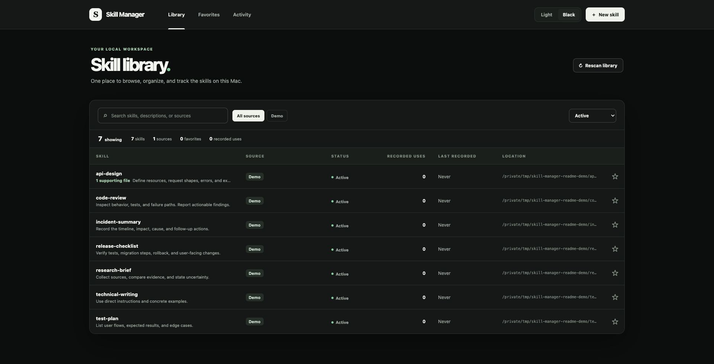
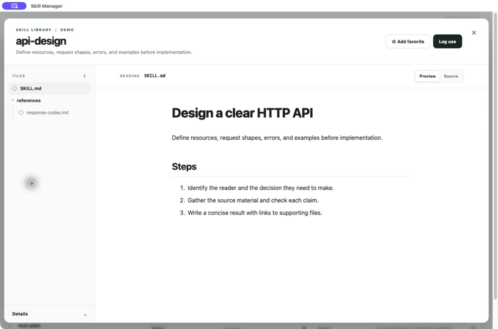

# Skill Manager

Skill Manager is a local app for reading and tracking the skills installed on your Mac. It scans skill folders, groups symlinked locations that point to the same `SKILL.md`, and keeps the source files read-only.

The reader formats Markdown instructions and references. You can favorite skills, keep private notes, archive library entries, create app-managed skills, and record use manually. Skill Manager does not collect agent telemetry.

## Screenshots

These screenshots use sample skills.

Browser library:

macOS skill reader:

## macOS sharing limitation

The local macOS build has an ad hoc signature, but Apple has not notarized it. A Mac that receives the app through AirDrop may show "Apple could not verify Skill Manager is free of malware." If you trust the copy, try to open it, then use **System Settings → Privacy & Security → Open Anyway**. [Apple's guide to opening unverified apps](https://support.apple.com/en-au/102445) explains this exception.

To share an app that opens without this warning, sign it with a Developer ID Application certificate and notarize it. See [Build the macOS app](docs/run.md#build-the-macos-app) for the current build steps and limits.

Use the guide that matches your task:

- [Run Skill Manager](docs/run.md) to build the macOS app or start the browser version.
- [Manage a skill](docs/manage-skills.md) to read files and record personal tracking data.
- [Local HTTP API](docs/api.md) for routes, request shapes, and limits.
- [Local skill inventory](docs/architecture.md) for discovery, identity, storage, and reader design.
